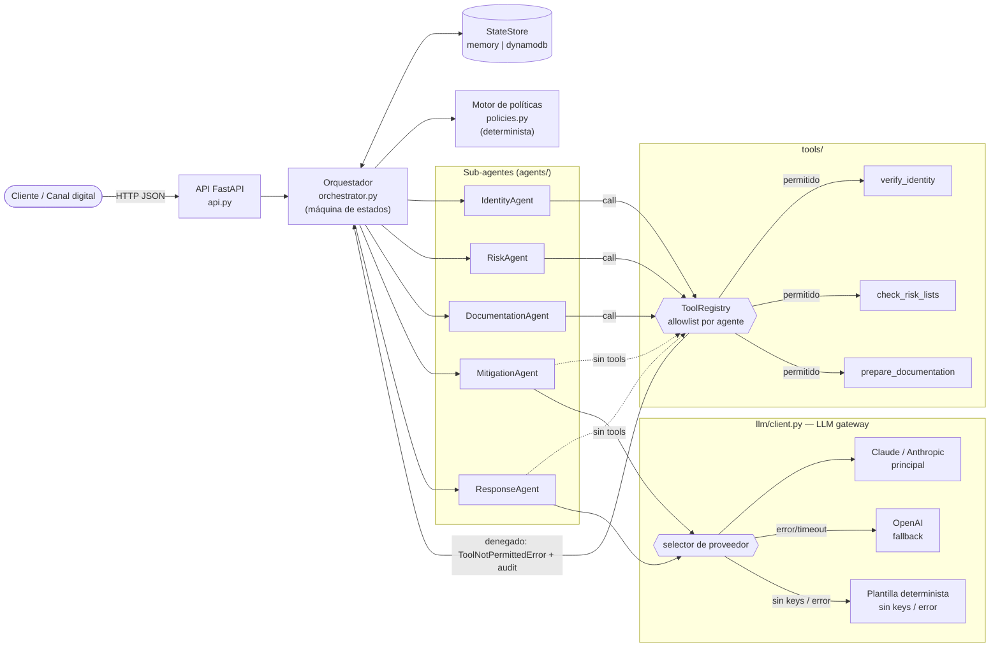
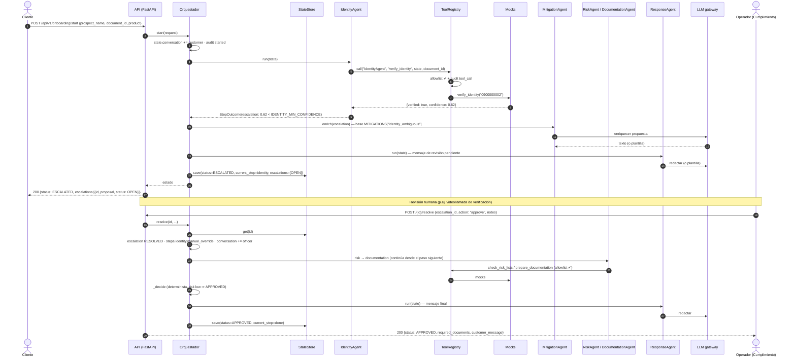
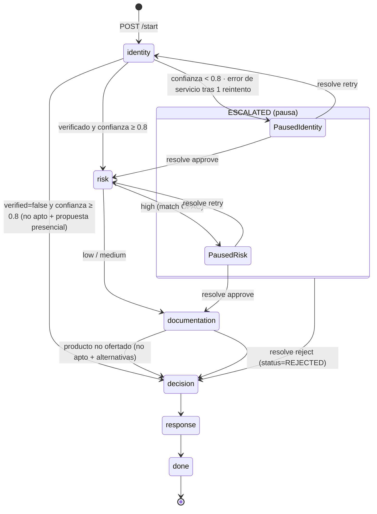
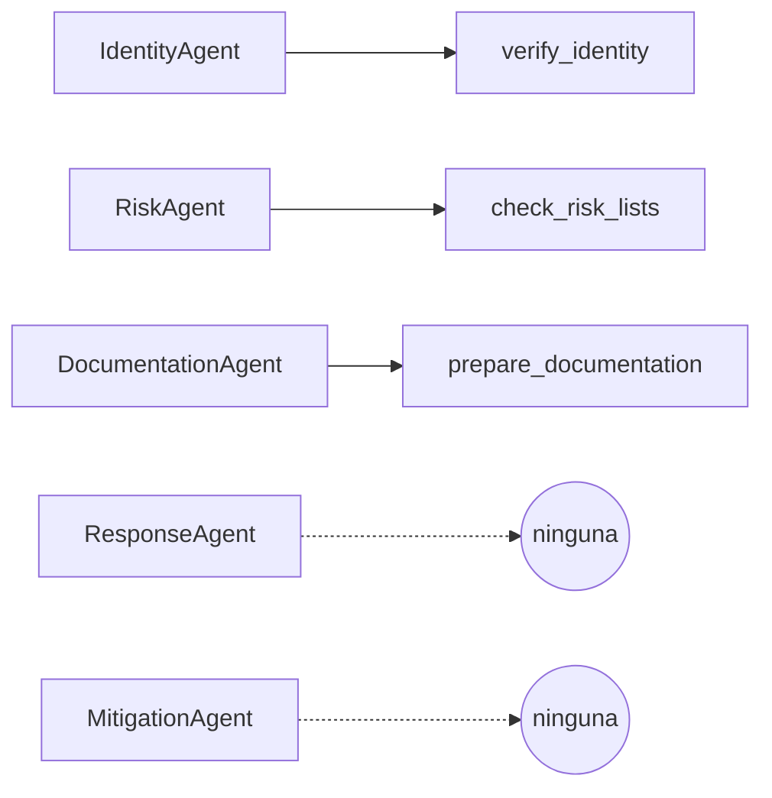
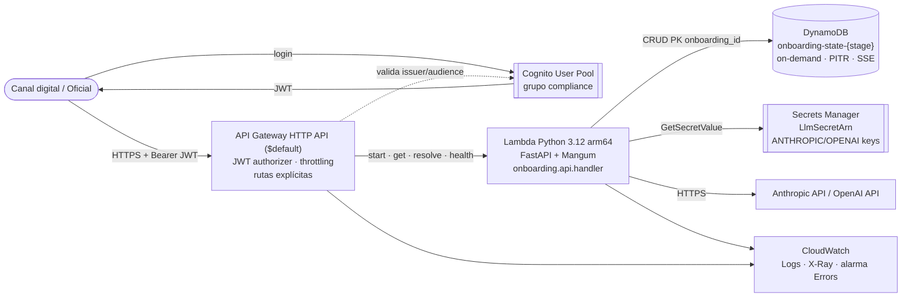

# Arquitectura — Agente Orquestador de Onboarding Digital

> Contrato funcional: [`SPEC.md`](SPEC.md) (fuente de verdad). Decisiones: [`adr/`](adr/).

## 1. Principios

1. **La decisión es determinista, el LLM solo redacta** ([ADR-0001](adr/0001-decision-determinista-llm-redacta.md)).
   El motor de políticas (`policies.py`) decide la aptitud; el LLM redacta el mensaje al cliente y enriquece
   propuestas. Sin keys el sistema funciona igual (plantillas).
2. **Mínimo privilegio por agente** ([ADR-0002](adr/0002-allowlist-tools-por-agente.md)). Cada sub-agente
   solo puede invocar las tools de su allowlist; el `ToolRegistry` lo hace cumplir y audita.
3. **Incertidumbre ⇒ escalar con propuesta, nunca adivinar.** Un resultado ambiguo o un fallo de servicio
   pausa el flujo (`ESCALATED`) con una propuesta concreta; un humano lo resuelve con `/resolve`.
4. **Estado explícito y persistido** entre pasos (`StateStore`: memoria local / DynamoDB), lo que permite
   reanudar tras un escalamiento y auditar todo el recorrido.
5. **Serverless en AWS** ([ADR-0003](adr/0003-serverless-aws.md)): API Gateway HTTP API → Lambda → DynamoDB.
6. **Autenticación JWT + rol de cumplimiento** ([ADR-0004](adr/0004-autenticacion.md)): Cognito + JWT
   authorizer en todas las rutas salvo `/health`; `/resolve` exige grupo `compliance`.
7. **Sin CI/CD** ([ADR-0005](adr/0005-sin-ci-cd.md)): despliegue manual `sam build && sam deploy --guided
   --profile ecopacific`, con el skill `verify` como gate local obligatorio.

## 2. Componentes

| Componente | Responsabilidad | No hace |
|---|---|---|
| `api.py` | Validación (Pydantic: `document_id` 10 dígitos → 422), rutas, `handler = Mangum(app)` | Lógica de negocio |
| `orchestrator.py` | `build_registry()` (registra tools + allowlist), máquina de estados (`_run`), reintento (`TOOL_MAX_ATTEMPTS=2`), escalamientos/reanudación (`resolve`), decisión (`_decide`), persistencia | Llamar tools directamente |
| `policies.py` | Umbrales y reglas (`IDENTITY_MIN_CONFIDENCE=0.8`, `TOOL_MAX_ATTEMPTS`, `PRODUCTS`, `ENHANCED_DUE_DILIGENCE_DOCS`, catálogo `MITIGATIONS`) | I/O |
| `agents/*` | Identity/Risk/Documentation heredan de `Agent` y devuelven `StepOutcome(data, escalation, reject_reason, proposal)`; Mitigation (`propose`/`enrich`) y Response (`run`) solo usan el LLM | Decidir aptitud final |
| `tools/registry.py` | `register`/`grant`/`call(agent, tool, state, **kw)`; lanza `ToolNotPermittedError`, audita `tool_call`/`tool_result`/`tool_denied`; `ToolError` = fallo de servicio | — |
| `tools/mocks.py` | Servicios externos simulados, deterministas por `document_id` | — |
| `llm/client.py` | `build_llm()` → `FallbackLLM` (Claude → OpenAI → `None` ⇒ plantilla del agente); keys de entorno o de Secrets Manager (`LLM_SECRET_ARN`) | Decidir |
| `state/store.py` | `build_store()`: `InMemoryStore` o `DynamoDBStore` (`STATE_BACKEND`, `STATE_TABLE`); `get/save`, ítem `{onboarding_id, status, state(JSON), updated_at}` | — |
| `models.py` | `OnboardingState` (incl. `proposals`, `conversation` customer/bank/officer), `Escalation`, `Status` (+ `IN_PROGRESS` interno), `STEPS` | — |

## 3. Secuencia — `/start` con escalamiento y `/resolve`

Ejemplo `document_id=0900000002` (identidad ambigua, confianza 0.62 < 0.8).

Variantes de `resolve`: `retry` vuelve a ejecutar el paso pausado (p.ej. tras caída del servicio en
`0900000005`); `reject` salta a `decision` y termina en `REJECTED` con la propuesta del escalamiento.
Errores: escalamiento inexistente → 404; ya resuelto → 409; onboarding inexistente → 404.

## 4. Máquina de estados

Pasos (`current_step`) y estados globales (`status`):

Estado final (`status`) que fija el paso `decision`:

| Condición (motor de políticas) | `status` |
|---|---|
| Identidad ok, riesgo `low`, producto válido | `APPROVED` |
| Riesgo `medium` (PEP) | `APPROVED_WITH_CONDITIONS` + documentos de debida diligencia reforzada |
| `verified=false` con confianza ≥ 0.8 · producto inexistente · `resolve reject` | `REJECTED` + propuesta |
| Confianza < 0.8 · riesgo `high` · servicio no disponible | `ESCALATED` (pausa en el paso) |

Producto inexistente: lo detecta `DocumentationAgent` sin invocar `prepare_documentation`; `REJECTED` con
propuesta de productos alternativos. Todo rechazo definitivo o aprobación con condiciones deja la solución
propuesta en `proposals[]` (RF3). Mientras corre, el estado interno es `IN_PROGRESS`.

## 5. Manejo de incertidumbre

| Fuente de incertidumbre | Detección | Mitigación |
|---|---|---|
| Identidad ambigua | `confidence < IDENTITY_MIN_CONFIDENCE (0.8)` | Escalamiento `severity` media con propuesta (verificación biométrica/videollamada); el humano decide |
| Identidad negativa con alta confianza | `verified=false`, conf ≥ 0.8 | No apto **con propuesta** (verificación presencial en agencia) — RF3 |
| Riesgo alto | `risk_level=high` / match OFAC | Nunca se aprueba automáticamente → escalamiento a Cumplimiento |
| Riesgo medio | `risk_level=medium` / PEP | Apto con condiciones + documentos extra |
| Servicio externo caído | `ToolError` en la tool | `TOOL_MAX_ATTEMPTS=2` (1 reintento, auditado `tool_error`); si persiste → escalamiento "servicio no disponible" con `retry` posible |
| LLM no disponible / lento / alucinación | error, timeout (`LLM_TIMEOUT`=6 s, sin reintentos del SDK), presupuesto agotado (`LLM_BUDGET`=15 s por ventana de 29 s) o sin keys | Fallback Claude → OpenAI → plantilla; peor caso ≈ presupuesto + 1 llamada < 29 s. El LLM **no** puede cambiar `status` ni `decision`: solo produce texto; la propuesta base sale del catálogo determinista |
| Entrada inválida | Pydantic | 422 antes de tocar el orquestador |

Todo evento (llamada a tool, denegación, reintento, escalamiento, resolución, decisión) queda en
`audit[]` con `ts`, `agent`, `event`, `detail`; el diálogo cliente/banco/oficial queda en `conversation[]`.
Por LOPDP ([ADR-0006](adr/0006-privacidad-y-retencion.md)) `detail` enmascara cédula (`******5678`) y
nombres (iniciales); el expediente en DynamoDB expira por TTL (`expires_at`, `STATE_TTL_DAYS`=90).

## 6. Permisos de tools

- El allowlist se define en **un solo lugar**: `orchestrator.build_registry()` hace `register(tool)` y
  `grant(agent, tool)`; el `ToolRegistry` guarda `{agent: {tools}}` (deny by default).
- Los agentes no importan los mocks: heredan `Agent.tool()`, que delega en
  `registry.call(self.name, tool, state, **kwargs)`.
- Llamada fuera del allowlist → `ToolNotPermittedError` + evento `tool_denied` en auditoría (defensa ante
  prompt injection o bug: un agente con LLM nunca obtiene capacidades nuevas).
- Los agentes con LLM (Response, Mitigation) **no reciben el registry**: su salida es texto, nunca acciones.
- En AWS el mismo principio se aplica a nivel IAM: la Lambda solo puede CRUD sobre su tabla y
  `GetSecretValue` sobre un único secreto.

## 7. Despliegue AWS

IaC: [`infra/template.yaml`](../infra/template.yaml) (SAM). Variables de entorno de la Lambda:
`AUTH_MODE=apigw`, `STATE_BACKEND=dynamodb`, `STATE_TABLE`, `LLM_PROVIDER`, `LLM_SECRET_ARN`, `ANTHROPIC_MODEL`, `OPENAI_MODEL`.
Si `LlmSecretArn` está vacío, `LLM_PROVIDER=none` y la política IAM del secreto no se crea.

Escalabilidad/coste: todo es pago por uso; el estado en DynamoDB hace a la Lambda stateless, por lo que
`/resolve` puede caer en cualquier instancia.

## 8. Autenticación y autorización

| Ruta | API Gateway | App (`AUTH_MODE=apigw`) |
|---|---|---|
| `GET /health` | pública (`Authorizer: NONE`) | — |
| `POST /api/v1/onboarding/start` | JWT válido (Cognito) | — |
| `GET /api/v1/onboarding/{id}` | JWT válido | — |
| `POST /api/v1/onboarding/{id}/resolve` | JWT válido | `cognito:groups` contiene `compliance`, si no 403 |

API Gateway rechaza (401) tokens ausentes, expirados o de otra audiencia **antes** de invocar la Lambda;
rutas no declaradas devuelven 404 sin coste de cómputo. En local no hay `AUTH_MODE` ⇒ sin autenticación.
